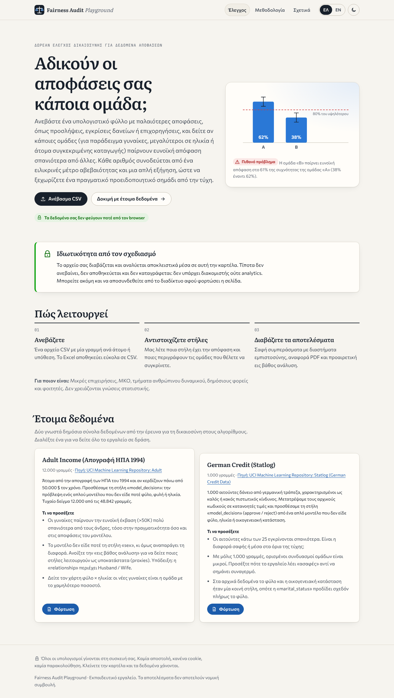
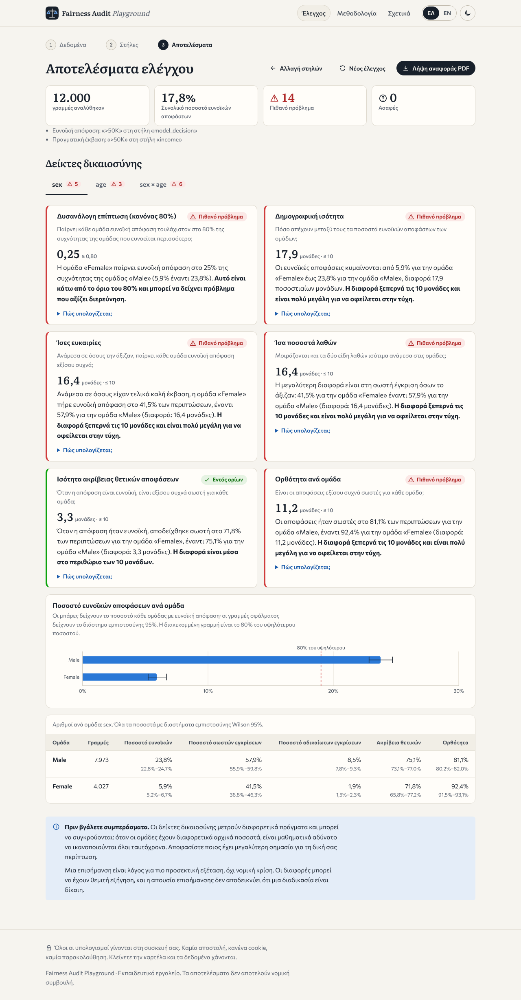
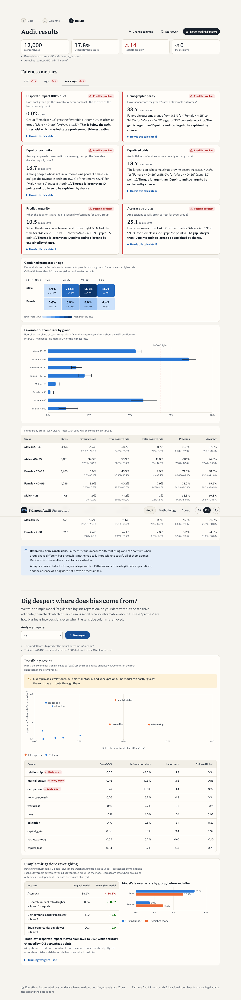

# Fairness Audit Playground

**Check whether a set of decisions treats any group unfairly — free, private, in your browser.**

Fairness Audit Playground lets people without a data-science team (small businesses, NGOs, HR staff,
public bodies, students) upload a CSV of past decisions — hiring, loan approvals, grants — and see
whether some groups receive the favorable outcome less often than others. Every number comes with a
confidence interval and a plain-language explanation in **Greek (default) or English**, so a real
warning sign can be told apart from noise.

> Educational tool. A flag is a reason to investigate, not a legal verdict.





_(Screenshots of the demo; replace them in `docs/screenshots/` as the app evolves.)_

## Why

Toolkits such as Fairlearn and AIF360 are excellent but need Python and a statistics background.
The people who actually make or review everyday decisions usually have a spreadsheet and a few
questions. This project brings the standard group-fairness checks to them, with honest uncertainty
and a strict privacy model.

## Features

- **Upload & data quality** — drag-and-drop CSV (comma, semicolon, tab), preview, automatic column
  type detection, warnings for missing values, constant / ID columns, tiny groups and ragged rows.
- **Column-mapping wizard** — decision column + favorable value(s), one or two sensitive attributes
  (numeric ones such as age are auto-binned into editable ranges), optional actual-outcome column.
- **Metrics** — selection rate, demographic parity (difference & ratio), disparate impact with the
  four-fifths rule, and with ground truth: equal opportunity, equalized odds, predictive parity and
  per-group accuracy. Wilson 95% intervals for every rate; Newcombe / Katz intervals for gaps and ratios.
- **Honest verdicts** — _Within threshold_, _Possible problem_, _Inconclusive_ (gap beyond threshold
  but its interval contains 0) or _Not enough data_ (< 30 rows). Never colour alone: icon + text.
- **Intersectional heatmap** (e.g. sex × age band) and metrics on the combined groups.
- **Dig deeper** — an L2-regularised logistic regression trained in a Web Worker _without_ the
  sensitive attribute; proxy detection (Cramér's V, normalised mutual information vs. permutation
  importance); before/after **reweighing** (Kamiran & Calders) showing the fairness / accuracy trade-off.
- **PDF report** — a print-optimised, branded report (dataset summary, mapping, findings, metrics with
  intervals, charts, limitations, date) via the browser's _Save as PDF_.
- **Demo data** — UCI Adult Income and German Credit, each with a source and a "what to look for" guide.
- **Methodology** and **About** pages; dark mode; keyboard navigation; responsive down to 360 px.

## Privacy model

- 100% client-side: the CSV is read with `FileReaderSync` inside a Web Worker and never leaves the tab.
  There is no backend, no analytics, no cookies; fonts are self-hosted.
- Only two `localStorage` keys are written: the chosen language and theme.
- The Netlify config ships a strict **Content-Security-Policy** with `connect-src 'self'`, so the page
  cannot send data to any other server even if a dependency tried to.
- Closing the tab discards the data.

## Run locally

Requires Node.js 20+ (22 recommended).

```bash
npm install
npm run dev        # http://localhost:5173
npm test           # Vitest unit tests (metrics, statistics, ML, CSV, i18n)
npm run lint       # ESLint (strict TS, no `any`)
npm run format     # Prettier
npm run build      # type-check + production build into dist/
npm run preview    # serve dist/ at http://localhost:4173
```

## Deploy to Netlify

`netlify.toml` already sets the build command (`npm run build`), the publish directory (`dist`),
Node 22, an SPA fallback redirect and security headers.

**Option A — drag and drop**

1. `npm install && npm run build`
2. Open <https://app.netlify.com/drop> and drag the `dist/` folder onto the page.
   (Headers from `netlify.toml` are not applied to drag-and-drop deploys; use Option B or the CLI for
   the CSP. With the CLI: `npx netlify-cli deploy --prod --dir=dist`.)

**Option B — from Git (recommended)**

1. Push this repository to GitHub / GitLab / Bitbucket.
2. In Netlify: _Add new site → Import an existing project_, pick the repository.
3. Netlify reads `netlify.toml`; just click _Deploy_. Every push to the default branch redeploys.

## Project structure

```
src/
  components/   UI: layout, upload, mapping, dashboard, deeper, report, ui primitives
  pages/        AuditPage, MethodologyPage, AboutPage
  lib/
    metrics/    stats.ts (Wilson, Newcombe, Katz), groups.ts, fairness.ts, audit.ts  ← pure, tested
    ml/         logistic.ts, association.ts, reweighing.ts, importance.ts, encode.ts, deeper.ts
    csv/        parse.ts (Papa Parse), profile.ts (types & data-quality warnings)
  workers/      audit.worker.ts + typed protocol and promise client
  i18n/         el.ts (default), en.ts, typed keys and Intl formatters
  data/         demo dataset metadata
public/data/    bundled demo CSVs
scripts/        prepare-demos.ts (rebuilds the demo CSVs from the UCI originals)
```

## Metric definitions

Notation: Ŷ = 1 favorable decision, Y = 1 good actual outcome, A = group.

| Metric                        | Definition                                            | Flag                                        |
| ----------------------------- | ----------------------------------------------------- | ------------------------------------------- |
| Selection rate                | SR(a) = P(Ŷ = 1 \| A = a)                             | —                                           |
| Disparate impact              | min SR / max SR                                       | < 0.8 (four-fifths rule, 29 CFR §1607.4(D)) |
| Demographic parity difference | max SR − min SR                                       | > 10 points                                 |
| Equal opportunity             | gap in TPR = P(Ŷ = 1 \| Y = 1, A = a)                 | > 10 points                                 |
| Equalized odds                | max(TPR gap, FPR gap), FPR = P(Ŷ = 1 \| Y = 0, A = a) | > 10 points                                 |
| Predictive parity             | gap in precision = P(Y = 1 \| Ŷ = 1, A = a)           | > 10 points                                 |
| Accuracy by group             | gap in P(Ŷ = Y \| A = a)                              | > 10 points                                 |

Comparisons use the lowest- vs highest-rate group among groups with ≥ 30 rows in the metric's
denominator. A flag becomes _Possible problem_ only if the 95% Newcombe interval of the gap excludes 0;
otherwise it is _Inconclusive_. Full details and references are on the in-app **Methodology** page.

## Demo data

| Dataset                       | Rows                     | Sensitive           | Source                                                                               |
| ----------------------------- | ------------------------ | ------------------- | ------------------------------------------------------------------------------------ |
| Adult Income (1994 US Census) | 12,000 sampled of 48,842 | sex, race, age band | [UCI](https://archive.ics.uci.edu/dataset/2/adult), CC BY 4.0                        |
| German Credit (Statlog)       | 1,000                    | age band, sex       | [UCI](https://archive.ics.uci.edu/dataset/144/statlog+german+credit+data), CC BY 4.0 |

German Credit codes were decoded into readable labels (sex and marital status were split from the
original combined attribute). Both files gained a `model_decision` column: 5-fold out-of-fold
predictions of a logistic regression that never saw sex, race, age or marital status, so the demo can
show error-based metrics. Rebuild with `npx vite-node scripts/prepare-demos.ts -- adult.csv german.csv`.

## Honest limitations

- Group metrics say nothing about individual cases and only cover the attributes you include.
- With different base rates, demographic parity, equalized odds and predictive parity cannot all hold
  (Kleinberg et al., 2016; Chouldechova, 2017). Choosing a metric is a value judgement.
- Error-based metrics treat the "actual outcome" as truth; if it was shaped by past decisions
  (selective labels), they inherit that bias.
- Each metric is tested separately at 95%; many comparisons raise the chance of a false alarm
  (no multiple-comparison correction is applied).
- Thresholds (80%, 10 points, 30 rows, V ≥ 0.25) are conventions, not legal standards.
- The logistic regression is deliberately simple and trained on at most 60,000 sampled rows; it
  illustrates proxy leakage and is not a production model. Reweighing is one of many mitigations.
- The PDF uses the browser's print engine; output can differ slightly between browsers.
- Not legal advice. See the EU AI Act (Regulation (EU) 2024/1689) and EU equality directives for context.

## License

Code: MIT. Demo datasets: CC BY 4.0 (UCI Machine Learning Repository).
